# Inkstone — 차분한 인포그래픽 디자인 시스템

AI·개발 강의, 신규 서비스 소개, AI 뉴스를 **1:1 포스트 썸네일 · 16:9 영상 · 9:16 숏폼**으로 만드는 디자인 시스템이에요. 돌색 바탕 + 잉크 + 인디고 한 가지. HTML로 짜고 PNG·MP4로 내보내며, 배치 검사기가 넘침·겹침·여백 문제를 잡아 줘요.

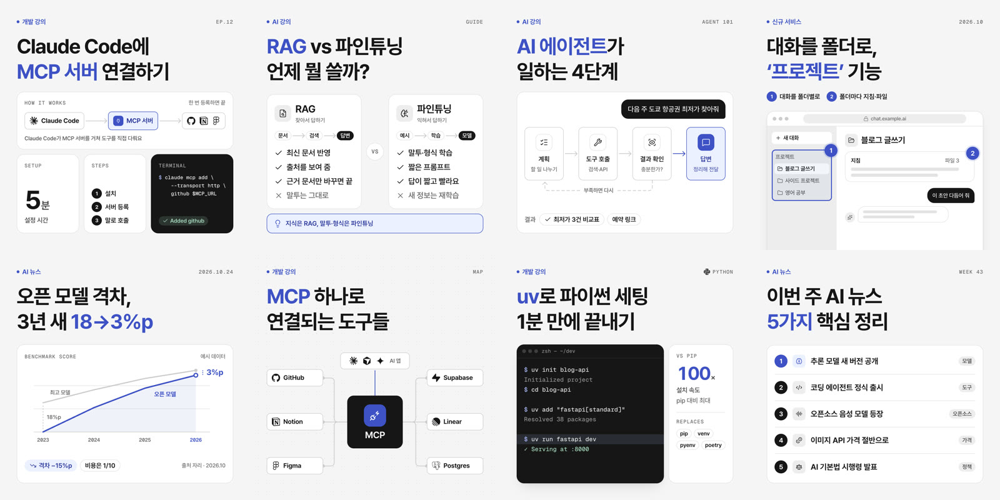

## 문서 지도

| 파일 | 대상 | 내용 |
|---|---|---|
| [`DESIGN.md`](DESIGN.md) | 사람·AI | **정본.** 토큰(YAML, [Google DESIGN.md](https://github.com/google-labs-code/design.md) 규격) + 색·글자·배치(계층과 넘침)·부품·아이콘·인포그래픽 패턴·모션·글쓰기·Do/Don't·에이전트 안내 |
| [`AGENTS.md`](AGENTS.md) | AI 에이전트 | 작업 절차, 글 유형 → 시작 프레임 표, 새 파일 시작 틀, 검사 결과 읽는 법, 명령 |
| [`CLAUDE.md`](CLAUDE.md) | Claude Code | `AGENTS.md`를 불러와요 |
| `README.md` | 처음 보는 사람 | 개요·빠른 시작 |

## 한눈에

- **색** — `canvas #F3F2EE` · `surface #FFFFFF` · `ink #1A1A18` · `accent #4353D1`. 인디고는 화면당 초점 1~2곳, 상태색(완료·대기·오류)은 뜻이 있을 때만.
- **글꼴** — Pretendard Variable(한글·영문) + Geist Mono(영문·숫자 꼬리표·코드). 행간은 한글 기준으로 넉넉하게(제목 1.2~1.3, 본문 1.6).
- **원칙** — 한 장 한 메시지 · 색은 의미에만 · 글보다 구조 · 그림자 대신 선과 면 · 꽉 차되 숨 쉬게(정보 4~7개, 빈 곳 30~40%).
- **표면** — 1:1(1080²) · 4:5(1080×1350) · 16:9(1920×1080) · 유튜브 썸네일(→1280×720) · 9:16(1080×1920, 플랫폼 UI 자리 비움).

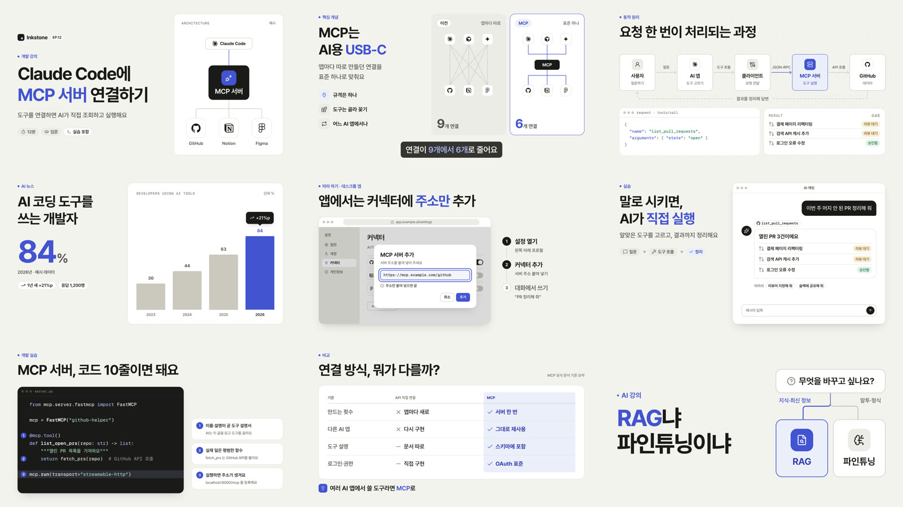

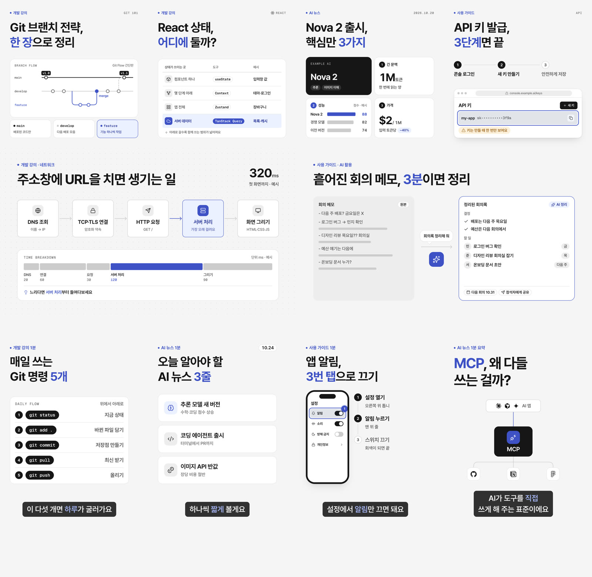

## 모션 (17종)

인포그래픽·설명 영상에서 자주 쓰는 움직임을 부품으로 만들었어요. 모두 CSS 애니메이션이라 그대로 MP4·GIF로 내보내요. 원본은 [`templates/motion.html`](templates/motion.html), 레시피와 쓰는 때는 DESIGN.md **Motion**에 있어요.

<table>
<tr><td width="33%" valign="top">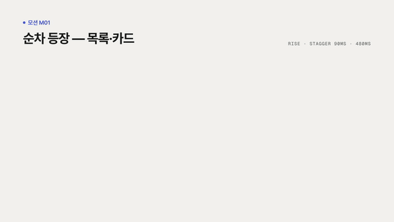<br><b>M01 순차 등장</b><br>목록·기능 소개</td><td width="33%" valign="top">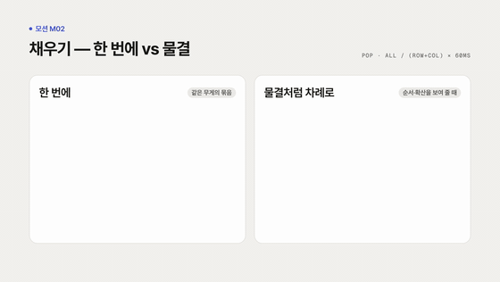<br><b>M02 한 번에 · 물결</b><br>묶음 / 퍼지는 순서</td><td width="33%" valign="top">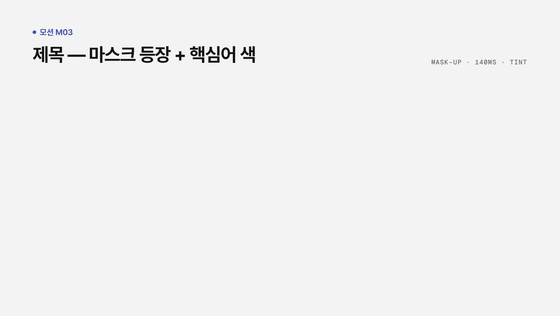<br><b>M03 제목 마스크 + 색</b><br>장면 첫 제목</td></tr>
<tr><td width="33%" valign="top">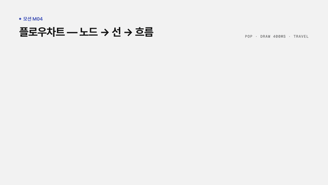<br><b>M04 플로우차트 그리기</b><br>작동 원리·과정</td><td width="33%" valign="top">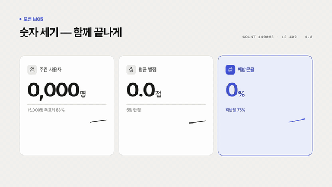<br><b>M05 숫자 세기</b><br>뉴스 수치·성과</td><td width="33%" valign="top">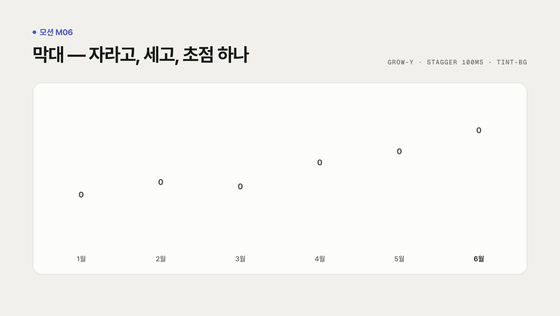<br><b>M06 막대 자라기</b><br>기간별 비교</td></tr>
<tr><td width="33%" valign="top">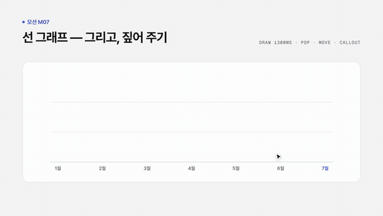<br><b>M07 선 그래프 + 툴팁</b><br>추세와 특정 시점</td><td width="33%" valign="top">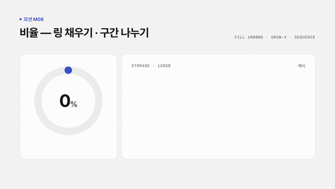<br><b>M08 링·구간 채우기</b><br>비율·구성</td><td width="33%" valign="top">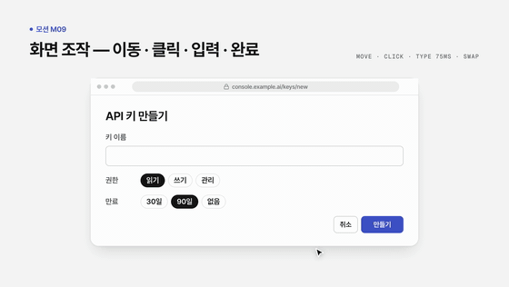<br><b>M09 커서·클릭·타이핑</b><br>사용 가이드·데모</td></tr>
<tr><td width="33%" valign="top">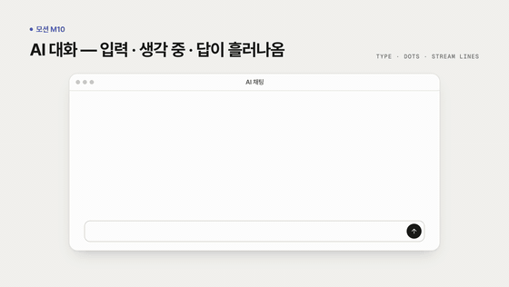<br><b>M10 대화 스트리밍</b><br>AI 사용법</td><td width="33%" valign="top">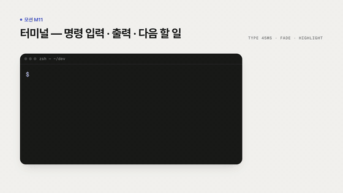<br><b>M11 터미널 타이핑</b><br>개발 튜토리얼</td><td width="33%" valign="top">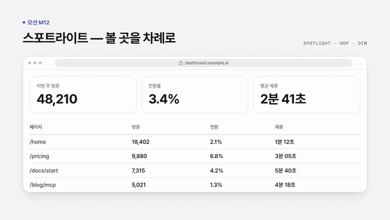<br><b>M12 스포트라이트 이동</b><br>화면·대시보드 설명</td></tr>
<tr><td width="33%" valign="top">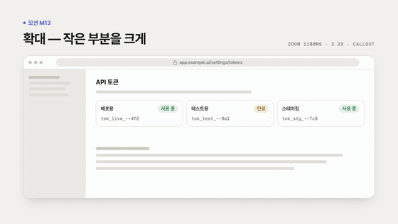<br><b>M13 카메라 확대</b><br>작은 부분 짚기</td><td width="33%" valign="top">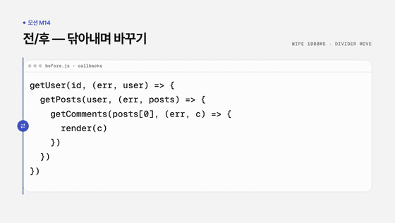<br><b>M14 전/후 닦아내기</b><br>개선 비교</td><td width="33%" valign="top">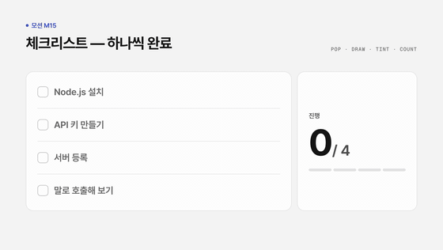<br><b>M15 체크리스트</b><br>단계 점검</td></tr>
<tr><td width="33%" valign="top">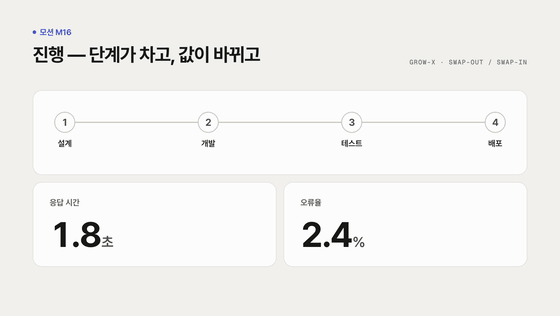<br><b>M16 단계 진행 · 값 바뀜</b><br>진행·개선 효과</td><td width="33%" valign="top">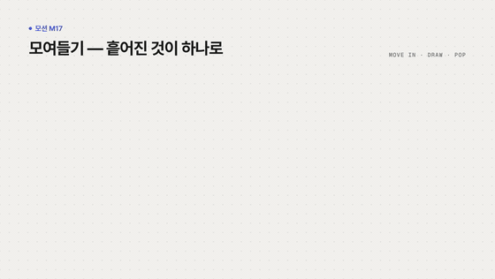<br><b>M17 모여들기</b><br>생태계·통합</td></tr>
</table>

```html
<span class="kicker" data-m="rise" style="--d: 100ms">분류</span>                  <!-- 아래에서 올라오며 등장 -->
<span class="mask"><span data-m="mask-up" style="--d: 300ms">제목 한 줄</span></span>  <!-- 마스크 등장 -->
<span class="count count--comma" data-m="count" style="--n: 12400"></span>         <!-- 0 → 12,400 -->
<path pathLength="1" data-m="draw" style="--d: 600ms" d="…"/>                       <!-- 선 그리기 -->
<span data-type data-type-delay="1500" data-type-step="70">my-blog-app</span>       <!-- 커서가 따라오는 타이핑 -->
```

## 빠른 시작

```bash
npm install                                                  # 처음 한 번 (Google Chrome 사용, MP4는 ffmpeg 필요)
open preview.html                                            # 시스템 미리보기(색·글자·아이콘·부품·결과물)
open templates/thumbnail.html                                # 템플릿 보드(장면은 누르면 모션 재생)

node scripts/render.mjs templates/thumbnail.html --audit     # PNG + 배치 검사
node scripts/render.mjs templates/video.html --video --audit # 장면별 PNG + MP4(30fps)
node scripts/render.mjs templates/motion.html --video --gif 560  # + README용 GIF
node scripts/render.mjs templates/video.html --only y1-youtube --width 1280   # 유튜브 1280×720 사본
npm run audit                                                # 모든 템플릿 검사만
npm run check                                                # DESIGN.md ↔ ds.css 토큰 일치 + DESIGN.md 린트
npm run render:all                                           # 전체 다시 내보내기
```

새 그래픽은 가장 비슷한 템플릿 프레임(`<section class="frame" data-frame="…">`)을 복사해 내용만 바꾸고, `--audit`가 오류·경고 0이 될 때까지 고친 뒤 PNG를 직접 확인해요. 절차는 [`AGENTS.md`](AGENTS.md)에 있어요.

## 구성

```
DESIGN.md                 정본 — 토큰 + 규칙
AGENTS.md · CLAUDE.md     에이전트 작업 안내
preview.html              시스템 미리보기(색·글자·아이콘·부품 시트 C1~C6·결과물 갤러리)
assets/ds.css             토큰 변수 + 부품 클래스(프레임·글자·카드·차트·다이어그램·화면·자막·모션)
assets/icons.js           Lucide 아이콘 180개 + Simple Icons 로고 80개 (<i data-icon> · <i data-logo>)
assets/motion.js          타이핑 도우미 (data-type: 글자마다 등장 + 따라오는 커서)
assets/stage.css·js       템플릿 보드와 렌더 API
templates/
  thumbnail.html          1:1 썸네일 8종 (벤토·비교·흐름·화면 소개·숫자+그래프·허브·터미널·목록)
  video.html              16:9 장면 11종 + 유튜브 썸네일 2종
  shorts.html             9:16 숏폼 5종
  cases.html              실전 검증 16장 (개발 강의 5 · 최신 뉴스 4 · 사용 가이드 4 · 서비스 소개 1 · 극한 테스트 2)
  motion.html             모션 카탈로그 17종 (M01~M17)
scripts/
  render.mjs              HTML → PNG·MP4 (--audit 배치 검사)
  audit.mjs               배치 검사 규칙
  check-tokens.mjs        DESIGN.md ↔ ds.css 값 비교
  build-icons.mjs         icons.js 생성
exports/                  렌더 결과(PNG·MP4·audit.json)
docs/                     README 미리보기 이미지
```

## 어떻게 검증했나

1. **배치 검사**(`scripts/audit.mjs`) — 실제 브라우저 좌표로 글자 잘림·상자 넘침·겹침·안전 영역·행간·외톨이 글자·작은 글자·제목 아래 간격·빈 띠·강조색 초점 수를 잰다. 템플릿·사례·모션·부품 시트 65장 모두 오류 0·경고 0.
2. **토큰 검사** — DESIGN.md의 색·글자 크기·행간·둥글기·간격이 `ds.css`와 같은지(`npm run check`), DESIGN.md 공식 린트 오류·경고 0.
3. **이미지 검토** — 렌더한 PNG를 직접 보고 균형·의미를 고치고, 독립 리뷰어(별도 AI)의 지적(판단 논리 오류, 시리즈 내용 불일치, 강조색 과다 등)을 반영했어요.

## 레퍼런스

제품 소개 랜딩 페이지(흰 면·1px 선·상태에만 색), Bento Grids 라이트 예시·Vercel Geist·Linear(선으로 나눈 타일·모노 꼬리표), FT·Economist식 차트(초점 하나만 색), ByteByteGo식 구조도, Untitled UI(역할 기반 무채색), Envato·Creative Market 인기 인포그래픽·캐러셀(시리즈 일관성), 토스 테크(차분한 집중). 무엇을 가져오고 무엇을 버렸는지는 DESIGN.md Overview 표에 있어요.

## 라이선스·고지

- 아이콘 [Lucide](https://lucide.dev) (ISC·일부 MIT), 로고 [Simple Icons](https://simpleicons.org) (CC0) — 라이선스 전문은 [`THIRD_PARTY_NOTICES.md`](THIRD_PARTY_NOTICES.md). 로고 상표권은 각 회사에 있어요. 뉴스·교육 맥락에서 원형 그대로, 단색으로만 쓰세요.
- 글꼴 [Pretendard](https://github.com/orioncactus/pretendard) (OFL), [Geist Mono](https://vercel.com/font) (OFL) — CDN으로 불러와요.
- 템플릿의 문구·수치·제품·화면은 모두 예시예요. 실제로 쓰기 전에 사실과 출처를 확인하세요.
